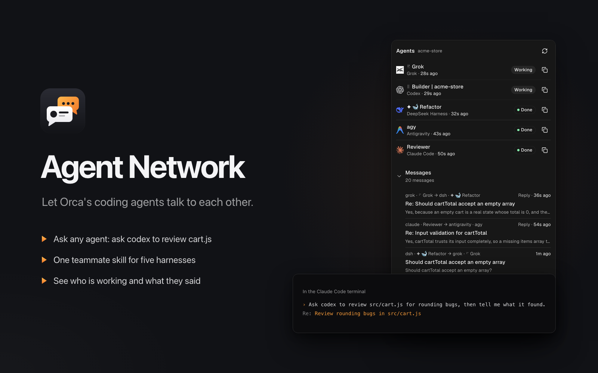

# Agent Network

**Let the coding agents of an Orca workspace talk to each other: "ask codex to review this" works from Claude Code, Codex, Grok, Antigravity, DeepSeek Harness and other harnesses.**

  

[Install](#install) · [Usage](#usage) · [Panel](#the-network-panel) · [Files](#what-it-writes) · [Uninstall](#uninstall) · [Access](#what-it-can-access) · [Limits](#requirements-and-limits) · [Development](#development)



Orca already ships a mailbox for agents (`orca orchestration send`, `check`, `reply`). What agents lack is the habit of using it with each other. Agent Network adds the teammate instructions (a skill) to every harness you have, so any agent knows how to find its peers, send a self-contained request and answer one it receives. A **Network** panel shows who is on the network and what they said. There is no background service and no extra CLI: the agents use Orca's own mail.

## Install

From the command line:

```sh
orca plugin install eRom/orca-plugin-agent-network
```

Orca shows the access the plugin asks for (see [What it can access](#what-it-can-access)) and enables it once you approve. The **Network** panel then appears in the sidebar.

The plugin does nothing to your agents until you install the teammate instructions, either with the **Install** button of the panel or with the command palette entry *Agent network: install teammate instructions*.

## Usage

In any agent of an Orca workspace, just ask:

- "ask codex to review the diff of this branch"
- "demande à grok de vérifier ce plan"
- "who is on the network?" lists the peers (agent, title, handle)
- invoking the skill with `whoami` (`/agent-network whoami` in Claude Code, `$agent-network whoami` in Codex) makes an agent answer with its own terminal handle; a handle given in a request (`term_…`) names the peer directly

The agent sends a message to the peer's terminal. The peer reads it, does the work, answers with `reply`, and the answer comes back into the first terminal. Agents never poll: each one is woken by Orca when mail arrives.

## The Network panel

- **Agents** of the focused workspace and their state (working, blocked, waiting, done), updated on Orca's agent status events.
- **Copy ID** button on each agent row: copies the agent's terminal handle (`term_…`) to the clipboard, to paste it into a request to another agent.
- **Messages**: the last 20 exchanged with a terminal of this workspace. They are read with `orca orchestration inbox`, never consumed, and refreshed every 5 seconds while the panel is visible.
- **Install status per harness**, with Install and Remove buttons.

The panel is available in English and French.

## What it writes

Installing writes one real copy of `SKILL.md` into each harness that is present on your machine:

| Folder | Harnesses |
| --- | --- |
| `~/.claude/skills/agent-network` | Claude Code |
| `~/.agents/skills/agent-network` | Codex, DeepSeek Harness and other harnesses reading the shared folder |
| `~/.grok/skills/agent-network` | Grok |
| `~/.gemini/config/skills/agent-network` | Antigravity |

A harness whose home folder is absent is skipped. Nothing else is written.

The plugin records every file it wrote with its SHA-256. **Remove** deletes only the files it wrote and you did not edit, then the folders it created if they are empty. An existing `agent-network` folder is left untouched, and shown as *Third-party folder*, only if it holds a `SKILL.md` the plugin did not write, or if it (or the skills folder) is a symbolic link. An empty existing folder simply receives the file.

## Uninstall

1. Press **Remove** in the panel first: it deletes the copies the plugin wrote.
2. Then uninstall the plugin with `orca plugin uninstall local.agent-network` (or the key shown by `orca plugin list`).

Uninstalling the plugin deletes its storage, ledger included. Copies still on disk at that point are no longer recognized as the plugin's own and show as *Third-party folder*: delete them by hand.

- `~/.claude/skills/agent-network`
- `~/.agents/skills/agent-network`
- `~/.grok/skills/agent-network`
- `~/.gemini/config/skills/agent-network`

## What it can access

Orca labels this plugin **Full access** (`trusted-worker`): it runs its own worker process on your machine with your user's rights. Here is exactly what it does with that.

| Capability | Why |
| --- | --- |
| `workspace:read` | Know the focused workspace, to list its agents and terminals. |
| `agent:read` | Read the agents and their state. |
| `storage:own` | Keep the install record and the panel language in the plugin's own storage. |

Beyond Orca's API, the worker:

- **runs the bundled `orca` CLI, read-only**: `orca orchestration inbox` and `orca terminal list`. It never runs `orca orchestration check`, which would consume your agents' mail.
- **runs the system clipboard command** (`pbcopy` on macOS, `clip` on Windows, `wl-copy` or `xclip` on Linux) only when you press **Copy ID**, to put that agent's handle on the clipboard.
- **writes only the four files above**, and the folders needed to hold them.
- **makes no network request** and collects no data.

## Requirements and limits

- **Orca 1.4.248 or later**. macOS is the tested platform.
- **Focused workspace only**: the panel never shows agents or messages of another workspace, and agents reach another workspace only through a handle (`term_…`) you give them.
- **Agents need a permissive mode**. In an "ask" permission mode, each `send`, `check` or `reply` waits for your approval.
- **Orca prints a "live terminal-only mailbox" warning** on every send. It is expected, and the skill tells agents to ignore it.
- **Orca 1.4.259 reports an agent waiting for input as Waiting** rather than Blocked, and the panel shows what Orca reports.
- **The feed scans the latest 200 messages of the whole Orca app**, so a busy multi-workspace Orca may show fewer than 20 messages for this workspace.
- **A new harness** needs a new entry in `src/targets.ts`.

## Development

```sh
orca plugin test . --json  # unit tests
bunx tsc -p .              # type check
orca plugin validate . --json
orca plugin check . --json
```

To try the plugin, install a frozen copy with `orca plugin install <folder>`. Do not `orca plugin dev load` a folder whose dot-folders change: Orca ties the approval to the whole folder, and any change disables the plugin until you approve it again.

Agent Network is a community plugin, not made or endorsed by Stably or by any of the agent vendors.

## License

[MIT](LICENSE)
